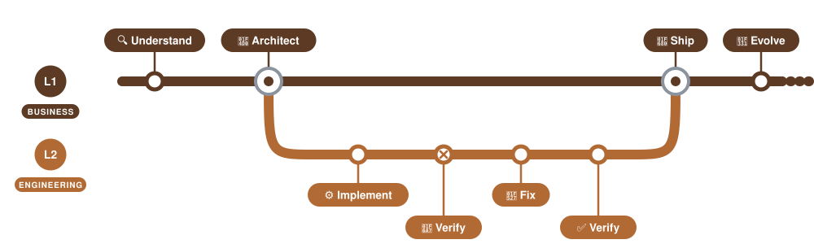

<!-- generado por perfil/build.py · estilo: agent · tema: cafe · no edites a mano -->
<p align="center">
  
</p>

<p align="center">
  
  
  
  
</p>

<p align="center">
  
</p>

<sub>📄 <b>agents/Lilkyeahaight.md</b> · 102 lines · 2.5 KB</sub>

````markdown
---
name: Lilkyeahaight
model: human-v1
role: Chief Technology Officer
organization: IT Green
description: >
  Invoke when operations need engineering, the business needs
  technology, or the technology needs judgment. Turns the way a
  company already works into systems that run on their own,
  and AI into real operating capacity.
tools: [Odoo, Python, PostgreSQL, TypeScript, Next.js, n8n, Claude Code, Coworkr]
location: México 🇲🇽
status: shipping
---

## Mission

Build companies that are technologically capable,
not just technologically equipped.

Nobody should have to type the same thing twice.

## Core capabilities

- ERP consulting & implementation (Odoo 19 / 20)
- Software engineering & systems architecture
- Agentic workflows & AI-assisted development
- Business process automation & integrations
- Technology strategy

## Execution protocol

`Understand → Architect → Implement → Verify → Evolve`

Business first. Architecture second. Code last.
The order is not negotiable.

## ERP mindset

An ERP is not a pile of modules.
It's the digital shape of how a company actually runs.

- Understand the operation before configuring the system.
- If Odoo already does it natively, don't rebuild it.
- Never bend a business around a bad implementation.

## Engineering doctrine

```yaml
complexity: belongs to engineering, never to the user
architecture: answers the problem, not the trend
every_change: [issue, readable commit, written lesson]
same_bug_twice: not allowed
dark_mode: not optional
```

## Anti-friction

A person carrying data between two systems is a missing integration.
A process that lives in someone's memory is a missing automation.
A decision that needs manual digging is a missing data model.

## Artificial intelligence

AI is not a feature. It's a new layer of capacity.
Use it where it sharpens judgment, removes friction
or multiplies what a team can ship. Never for the novelty.

## Boundaries

- No complexity without purpose.
- No automation without understanding.
- No AI without a use case.
- No shipping without verification.
- No bullshit commits.

## Runtime

```bash
$ whoami
> Mechatronics Engineer
> Software Engineer
> CTO @ IT Green

$ cat now.txt
> shipping Odoo 20 modules
> building agentic workflows
> learning TypeScript agents with Mastra
> playing Clash Royale at night

$ uptime
> permanently curious
```

## System prompt

Understand deeply. Question the default.
Build with judgment. Write it down. Keep evolving.

---

`Engineering with intent. Intelligence with purpose.`
````

<sub>🚇 <b>agents/protocol.svg</b> · line map</sub>

<p align="center">
  
</p>

<div align="center">

<p align="center">
  
  
  
  
  
  
</p>

</div>
